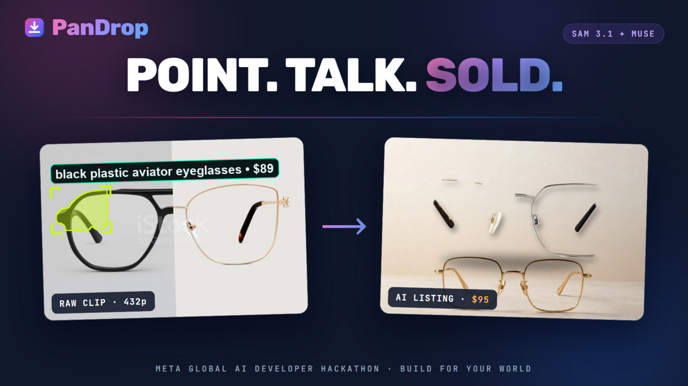
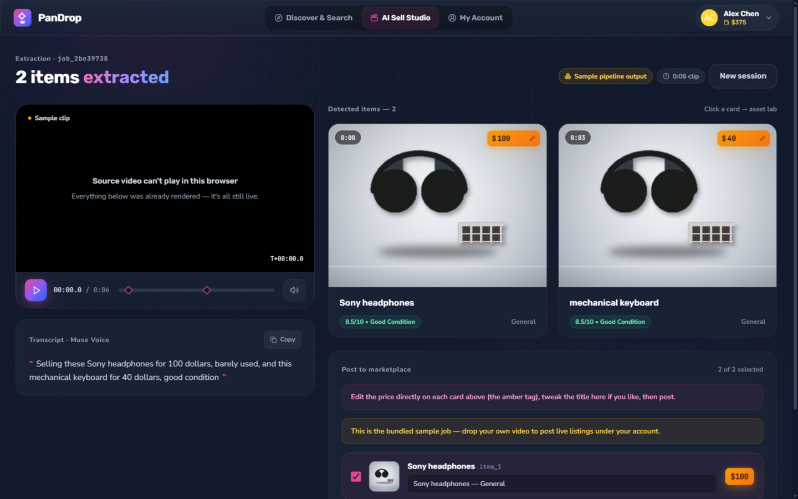
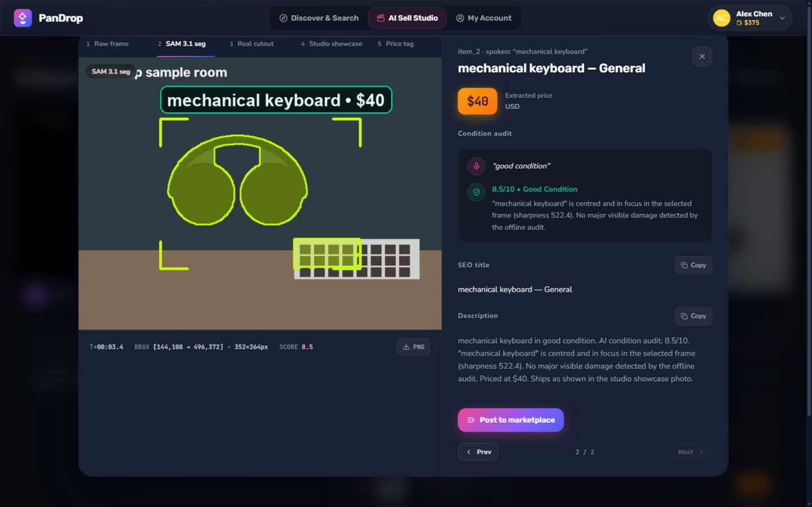
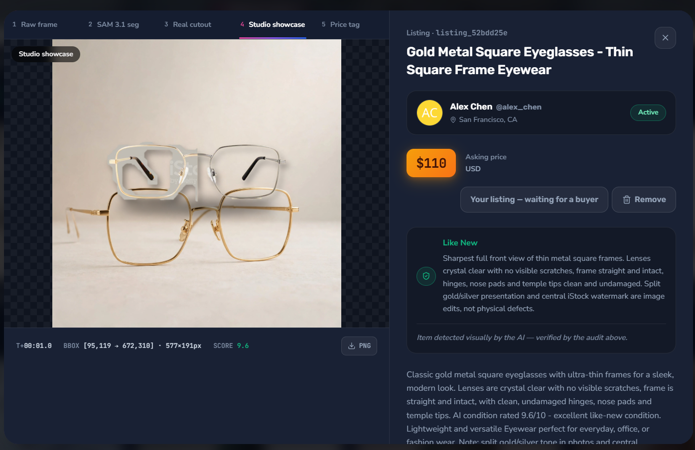
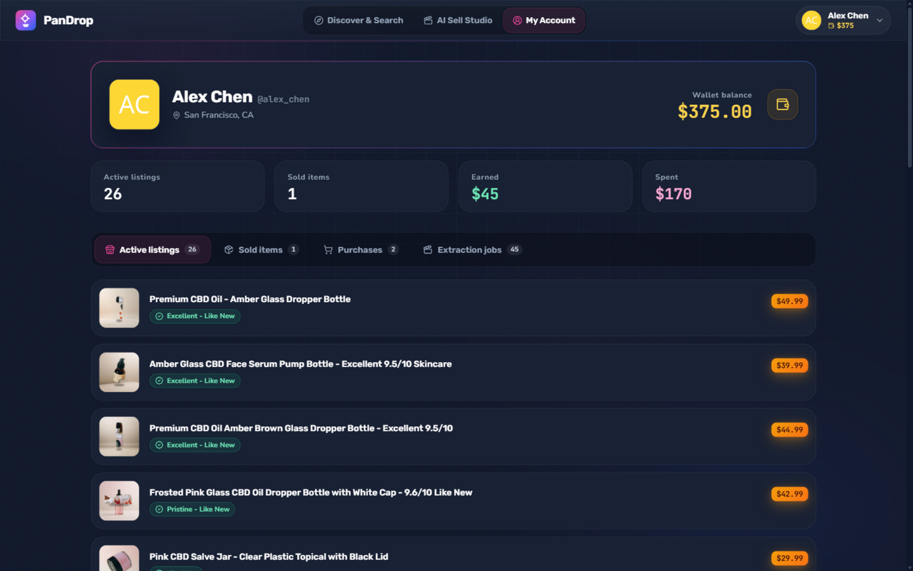
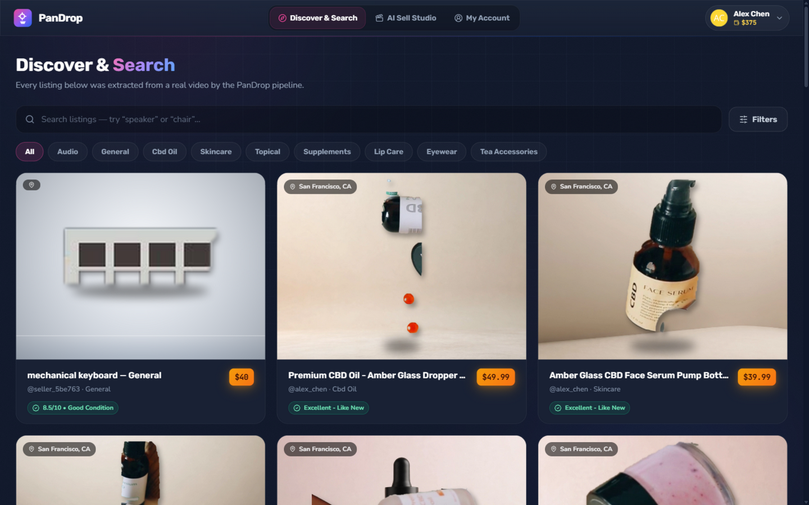
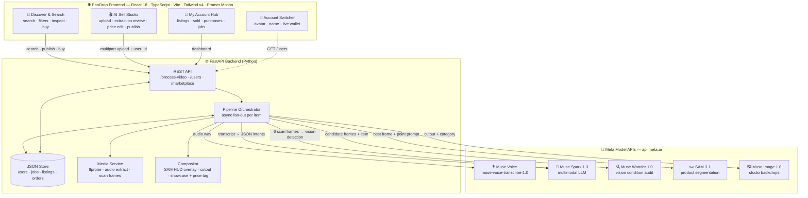
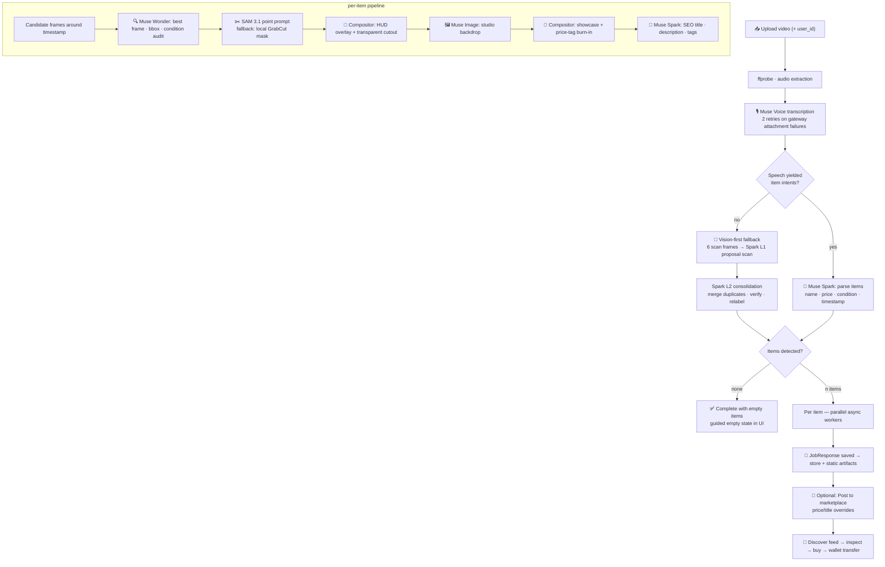

# 🎯 PanDrop — Point. Talk. Sell & Discover.

> An AI Video-to-Showcase **P2P Marketplace** built for the **Meta Global AI Developer Hackathon**.
> Drop a video, talk about your products — Meta's models segment them, audit them, photograph them, and list them.

<p align="center">
  
</p>

---

## 🎬 Demo Video

https://github.com/user-attachments/assets/632db0cd-a933-4d97-99c5-c7ecf1949410


<p align="center">
  <video src="docs/demo/demo.mp4" controls muted width="860" poster="docs/screenshots/studio-extraction.png">
    Your browser does not support the video tag.
  </video>
</p>

<p align="center"><i>Full walkthrough: upload → live pipeline → editable prices → post to marketplace → switch account → discover → inspect authenticity → buy.</i></p>

---

## 📸 Screenshots

| AI Sell Studio — extraction results | Asset Lab — SAM 3.1 inspection |
|---|---|
|  |  |

| Listing authenticity inspector | My Account Hub |
|---|---|
|  |  |

| Dashboard — live marketplace feed |
|---|
|  |

---

## ✨ What we built

### 1. AI Sell Studio — video → listings
- **Drag & drop any product video** (MP4/MOV/WEBM). The backend probes it, extracts the audio track and pulls candidate frames.
- **Speech-driven extraction** — Muse Voice transcribes the seller, Muse Spark parses every item (name, asking price, spoken condition, timestamp).
- **Vision-first extraction** — clips with no narration still work: the pipeline scans 6 evenly-spaced frames and Muse Spark *visually detects* sellable products (multi-layer: proposal scan → consolidation/verification).
- **Per-item pipeline**: best-frame selection → SAM 3.1 segmentation → transparent cutout → studio showcase with the price burned in → SEO listing copy.
- **Editable before posting** — the amber price tag on every card is an inline editor; titles are tweakable; then **Post to Marketplace** with price/title overrides.

### 2. Discover & Search — the marketplace feed
- Full-text search, category pills, max-price and minimum-AI-condition filters.
- Every listing card crossfades from the studio shot to the **price-tag-burned variant** on hover.
- **Inspect authenticity**: a 5-stage viewer (Raw frame → SAM 3.1 mask → Real cutout → Studio showcase → Price tag) with telemetry (timestamp, bounding box, score) and PNG downloads.
- **Buy now** with wallet balance — balance updates for buyer *and* seller instantly.

### 3. My Account Hub — selling + buying in one place
- Unified accounts (one account sells *and* buys), one-click **account switcher** in the top bar with live wallet balance, plus a create-account modal ($500 starting wallet).
- Dashboard: **Active listings**, **Sold items + earnings**, **Purchases**, and every **Extraction job** (re-openable in the studio to post remaining items).

### 4. Accuracy & resilience engineering
- **Multi-layer extraction**: L1 proposal scan → L2 consolidation/verification (merge duplicates, drop mislabels) → L3 per-item Wonder audits.
- **Graceful degradation everywhere**: gateway audio attachment failures, missing narration and unreachable backends all degrade to honest states — never fake data, never a dead error screen.
- **Backend port auto-discovery** — the frontend probes candidate API bases and locks onto the real PanDrop backend, so "Failed to fetch" can't happen from a port mismatch.

---

## 🏗️ Architecture



### Pipeline — one video, end to end



### Model orchestration

| Model | Version used | Triggered when | Role | On gateway failure |
|---|---|---|---|---|
| **Muse Voice** | `muse-voice-transcribe-1.0` (multimodal Spark path) | every upload | Speech → transcript (2 retries with backoff) | Falls back to transcript-heuristic extraction |
| **Muse Spark** | `muse-spark-1.3` | every upload | Transcript → item intents (JSON) · listing copy · **vision-only product detection** (multi-layer) | Heuristic parser / keeps L1 proposals |
| **Muse Wonder** | `muse-wonder-1.0` | per item | Best-frame selection · bounding box · condition score + badge + notes · **claim-vs-frames honesty check** | Sharpness-based local audit |
| **SAM 3.1** | `sam-3.1` | per item | Point-prompt segmentation mask → HUD overlay + transparent cutout | Local **GrabCut** mask seeded by bbox |
| **Muse Image** | `muse-image-1.0` | per item | Category-aware studio backdrop generation | Procedural gradient backdrop |

> **Accuracy = layers.** L1 proposals are re-verified by an L2 consolidation pass (duplicates merged, non-products dropped, labels corrected to *colour + material + object*), and L3 Wonder audits re-check every surviving item against its real frames.

---

## 🛡️ Resilience design

- **Never fake, never dead.** Every Meta call has a genuine local fallback (GrabCut masks, sharpness audits, procedural backdrops) — jobs always complete with *honest* output.
- **Voice-model refusals** ("no audio attached") are detected and treated as an empty transcript, then retried — the gateway's audio attachment is intermittent.
- **No-speech jobs complete with an empty list** and a guided empty state, never a fake "Featured item".
- **Frontend auto-discovers the backend port** (probes 8000/8010/8020) — port conflicts can't produce "Failed to fetch".
- **Eager upload requests** prevent React StrictMode double-POSTs; view transitions are animation-independent so the UI can't freeze invisible.

---

## 🚀 Quickstart

```bash
# 1 — Backend
cd pandrop-backend
pip install -r requirements.txt
copy .env.example .env          # then fill in META_API_KEY + META_API_BASE_URL
# required in .env for live models:
#   META_API_KEY=<your key>
#   USE_MOCK_AI=false
#   USE_MOCK_MODELS=false
uvicorn app.main:app --port 8000

# 2 — Frontend
cd ../pandrop-frontend
npm install
npm run dev                     # http://localhost:5173
```

Verify live mode: `GET http://localhost:8000/api/v1/health` → `"mock_ai": false`.
Port 8000 busy? Start the backend on another port — the frontend auto-discovers it (or set `VITE_API_BASE_URL`).

---

## 📡 API reference

| Method | Endpoint | Purpose |
|---|---|---|
| `POST` | `/api/v1/process-video` | Multipart `file` + `user_id` → synchronous extraction (`JobResponse`) |
| `GET` | `/api/v1/jobs/{job_id}` | Fetch a finished job |
| `GET` / `POST` | `/api/v1/users` | List / create unified accounts |
| `GET` | `/api/v1/users/{id}/dashboard` | Listings, sold, purchases, extraction jobs |
| `POST` | `/api/v1/marketplace/publish` | Publish extracted items (price/title overrides) |
| `GET` | `/api/v1/marketplace/listings` | Search + filter the feed |
| `POST` | `/api/v1/marketplace/{id}/buy` | Wallet-based purchase |
| `GET` | `/api/v1/health` | Liveness + `mock_ai` flag |
| `GET` | `/static/…` | Per-job artifacts (frames, masks, cutouts, showcases) |

---

## 📁 Project structure

```
├─ pandrop-backend/          # FastAPI + Meta Model APIs + JSON store
│  └─ app/
│     ├─ main.py             # routes: jobs, accounts, marketplace
│     ├─ schemas.py          # Pydantic contract
│     ├─ config.py           # .env settings (META_API_KEY, mock flags)
│     └─ services/           # pipeline · meta_ai · store · media · compositor
├─ pandrop-frontend/         # React 18 + Vite + Tailwind v4 + Framer Motion
│  └─ src/
│     ├─ types/pandrop.ts    # exact backend contract
│     ├─ lib/                # api client (auto port discovery) · demo preset
│     └─ components/         # Discover · Studio · AccountHub · AssetLab · …
└─ docs/
   ├─ screenshots/           # app captures used in this README
   └─ demo/                  # ⬅️ drop your demo video here (demo.mp4)
```

---

## 🧪 Verified end-to-end

- Speech-driven extraction (Sony headphones $100 / mechanical keyboard $40 from a real transcript)
- Vision-only extraction (3 eyeglasses and 4 matcha-watcher items detected from silent b-roll, correctly labelled after consolidation)
- Price editing → publish → live listing → account switch → discover → inspect → buy → wallet transfer (Alex $545 / Maya $455)
- Graceful paths for silent clips, gateway attachment failures and missing video codecs

---

Built with ❤️ for the **Meta Global AI Developer Hackathon** — powered by **Muse Voice · Muse Spark · Muse Wonder · SAM 3.1 · Muse Image**.
